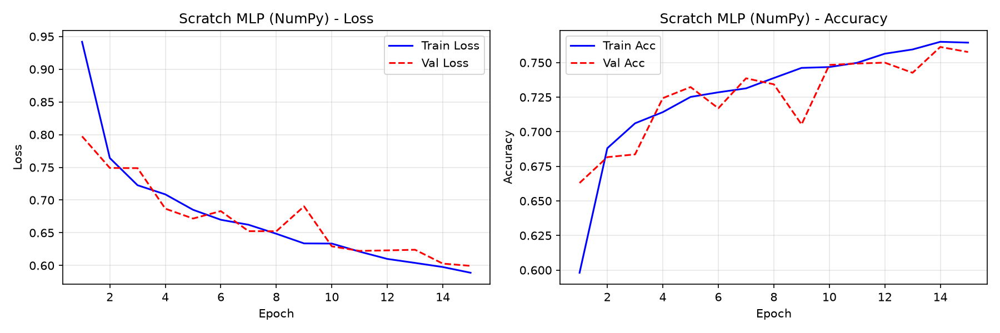
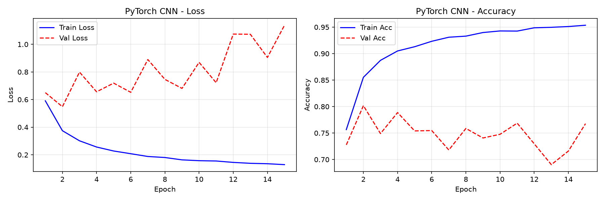
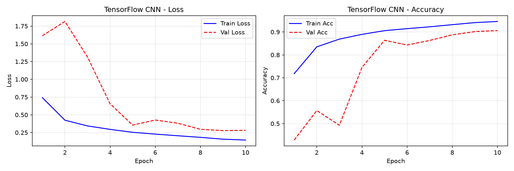

# Benchmark Comparativo en CIFAR-10 (3 Clases): Red Neuronal Desde Cero (NumPy) vs. PyTorch vs. TensorFlow

Trabajo técnico y experimental de Machine Learning Engineering y Deep Learning que compara el desarrollo y entrenamiento de redes neuronales bajo dos paradigmas:
1. **Entrenamiento "a pulso" (First-Principles):** Red neuronal densa (MLP) implementada desde cero utilizando exclusivamente **NumPy**, deduciendo analíticamente el cálculo matricial de forward/backward propagation, funciones de activación, regularización y el optimizador Adam con corrección de sesgo.
2. **Entrenamiento con librerías especializadas:** Redes Neuronales Convolucionales (CNN) profundas con capas de convolución 2D, Batch Normalization, Dropout y aceleración por hardware implementadas en **PyTorch** y **TensorFlow / Keras**.

---

## 1. Formulación del Problema y Selección de Clases

El conjunto de datos **CIFAR-10** contiene 60.000 imágenes a color de $32 \times 32$ píxeles distribuidas equitativamente en 10 categorías (50.000 en entrenamiento y 10.000 en prueba). 

Para este estudio comparativo de laboratorio, se aislaron **3 clases representativas** con el objetivo de evaluar la capacidad de discriminación morfológica y espacial:

| Índice Original | Índice Remapeado | Categoría | Dominio / Modalidad | Características Visuales y Desafíos Inductivos |
| :---: | :---: | :---: | :---: | :--- |
| `0` | `0` | **`airplane`** (avión) | Antropogénico / Aéreo | Geometría rígida, bordes rectos, relación de aspecto alargada, fondos dominados por cielo y nubes. |
| `1` | `1` | **`automobile`** (auto) | Antropogénico / Terrestre | Simetría estructural, reflejos metálicos, ruedas, texturas urbanas y asfalto. |
| `2` | `2` | **`bird`** (pájaro) | Biológico / Orgánico | Cuerpos deformables, posturas no rígidas, textura de plumas, fondos naturales con ramas, pasto o cielo. |

### Justificación Académica de la Selección
1. **Varianza Inter-clase vs. Intra-clase:** Autos y aviones presentan estructuras artificiales rígidas y regulares, mientras que los pájaros introducen deformabilidad biológica y patrones orgánicos complejos.
2. **Desacoplamiento Figura-Fondo:** Tanto los aviones como los pájaros comparten recurrentemente fondos de cielo azul y nubes. Esto obliga al modelo a aprender representaciones visuales invariantes del objeto (alas y fuselaje vs. plumaje y cabeza) en lugar de apoyarse en atajos espurios como el color de fondo.
3. **Equilibrio Estadístico:** Al conservar las clases 0, 1 y 2, se obtiene un subconjunto perfectamente balanceado de **15.000 muestras de entrenamiento** (5.000 por clase) y **3.000 muestras de prueba** (1.000 por clase).

---

## 2. Implementación "A Pulso": Red Neuronal Desde Cero (`NumPy`)

El módulo `src/from_scratch/` fue programado prescindiendo por completo de bibliotecas de autograd (como PyTorch Autograd o JAX). Cada operación vectorial, gradiente y actualización de parámetros fue formulada y derivada matemáticamente a mano.

### 2.1 Limitación Teórica: Aplanamiento y Pérdida de Localidad Espacial
Para alimentar una red densa (*Multi-Layer Perceptron* o MLP), las imágenes tridimensionales de $32 \times 32 \times 3$ deben colapsarse en un vector unidimensional de $3.072$ componentes:

$$X \in \mathbb{R}^{m \times 3072}$$

> **Nota Conceptual:** Al aplanar la imagen, la red pierde la **invarianza a traslaciones** y la **vecindad espacial 2D**. Dos píxeles adyacentes verticalmente quedan separados por cientos de posiciones en el vector, forzando a la red densa a aprender relaciones globales mucho más costosas en parámetros y propensas al sobreajuste.

### 2.2 Arquitectura del MLP Desde Cero
* **Capa de Entrada:** $3.072$ nodos (píxeles normalizados en $[0, 1]$).
* **Capa Oculta 1:** $256$ neuronas con activación **ReLU** e inicialización **He Normal**.
* **Capa Oculta 2:** $64$ neuronas con activación **ReLU** e inicialización **He Normal**.
* **Capa de Salida:** $3$ neuronas con activación **Softmax** e inicialización **Xavier Normal**.
* **Total de parámetros entrenables:** **$803.139$**.

### 2.3 Formulación Matemática y Propagación hacia Adelante (Forward Pass)
Para un mini-batch de $m$ muestras en la capa $l$:

$$Z^{[l]} = A^{[l-1]} W^{[l]} + b^{[l]}$$

Donde $W^{[l]} \in \mathbb{R}^{d_{l-1} \times d_l}$, $b^{[l]} \in \mathbb{R}^{1 \times d_l}$ y $A^{[0]} = X$.

* **Activación ReLU (Rectified Linear Unit):**
  $$A^{[l]} = \max(0, Z^{[l]})$$
* **Softmax Numéricamente Estable:**
  Para evitar desbordamiento por punto flotante (*overflow*) en la exponencial $\exp(z)$ cuando $z \gg 0$, se sustrae el máximo por fila:
  $$\hat{Y}_{ik} = \frac{\exp(Z_{ik} - \max_j Z_{ij})}{\sum_{j=1}^K \exp(Z_{ij} - \max_j Z_{ij})}$$

### 2.4 Función de Pérdida (Entropía Cruzada Categórica)
$$\mathcal{L} = -\frac{1}{m} \sum_{i=1}^m \sum_{k=1}^K Y_{ik} \ln(\hat{Y}_{ik} + \epsilon) + \frac{\lambda}{2m} \sum_{l} \|W^{[l]}\|_F^2$$

donde $\epsilon = 10^{-15}$ previene singularidades numéricas ($\ln 0$) y $\lambda$ es el factor de decaimiento de pesos $L_2$.

### 2.5 Deducción Analítica de Gradientes (Backward Pass)
El gradiente analítico de la combinación conjunta Softmax + Entropía Cruzada respecto a los *logits* de salida $Z^{[L]}$ se simplifica elegantemente a:

$$\frac{\partial \mathcal{L}}{\partial Z^{[L]}} = \frac{1}{m} (\hat{Y} - Y) \in \mathbb{R}^{m \times K}$$

Propagando la regla de la cadena hacia las capas previas $l$:
$$\frac{\partial \mathcal{L}}{\partial W^{[l]}} = (A^{[l-1]})^T \left(\frac{\partial \mathcal{L}}{\partial Z^{[l]}}\right) + \frac{\lambda}{m} W^{[l]}$$

$$\frac{\partial \mathcal{L}}{\partial b^{[l]}} = \sum_{i=1}^m \left(\frac{\partial \mathcal{L}}{\partial Z^{[l]}}\right)_{i, :}$$

$$\frac{\partial \mathcal{L}}{\partial A^{[l-1]}} = \left(\frac{\partial \mathcal{L}}{\partial Z^{[l]}}\right) (W^{[l]})^T$$

$$\frac{\partial \mathcal{L}}{\partial Z^{[l-1]}} = \frac{\partial \mathcal{L}}{\partial A^{[l-1]}} \odot \mathbb{I}(Z^{[l-1]} > 0)$$

### 2.6 Estrategia de Inicialización de Pesos
* **He (Kaiming) Normal** para capas intermedias con activación ReLU:
  $$W \sim \mathcal{N}\left(0, \sqrt{\frac{2}{d_{\text{in}}}}\right)$$
  Mantiene la varianza de las activaciones constante a lo largo de las capas profundas, previniendo el desvanecimiento de gradientes.
* **Xavier (Glorot) Normal** para la proyección lineal hacia la salida:
  $$W \sim \mathcal{N}\left(0, \sqrt{\frac{2}{d_{\text{in}} + d_{\text{out}}}}\right)$$

### 2.7 Optimizador Adam Implementado a Pulso
Se programó el algoritmo Adam completo con estimadores de momento de primer orden ($m_t$, media del gradiente) y segundo orden ($v_t$, varianza no centrada) con corrección analítica de sesgo por inicialización en cero:

$$m_t = \beta_1 m_{t-1} + (1 - \beta_1) g_t, \quad v_t = \beta_2 v_{t-1} + (1 - \beta_2) g_t^2$$

$$\hat{m}_t = \frac{m_t}{1 - \beta_1^t}, \quad \hat{v}_t = \frac{v_t}{1 - \beta_2^t}$$

$$\theta_t = \theta_{t-1} - \frac{\alpha}{\sqrt{\hat{v}_t} + \epsilon} \hat{m}_t$$

### 2.8 Configuración e Hiperparámetros del Entrenamiento
* **Optimizador:** Adam ($\beta_1 = 0.9$, $\beta_2 = 0.999$, $\epsilon = 10^{-8}$).
* **Tasa de aprendizaje ($\alpha$):** $0.001$.
* **Decaimiento de pesos ($L_2$ weight decay):** $10^{-4}$.
* **Tamaño de lote (batch size):** $128$.
* **Épocas:** $15$.

### Curvas de Aprendizaje (NumPy Desde Cero)


---

## 3. Implementación con Librerías Especializadas: CNN en PyTorch y TensorFlow

Para comparar de forma rigurosa la ingeniería first-principles frente a herramientas de la industria, se diseñó una **arquitectura Convolucional idéntica y sincronizada** tanto en PyTorch como en TensorFlow/Keras.

### 3.1 Ventajas Estructurales de la Convolución 2D
A diferencia de la red densa:
1. **Campos Receptivos Locales:** Cada neurona procesa vecindarios contiguos de $3 \times 3$ píxeles, preservando patrones geométricos locales (bordes, curvas, texturas).
2. **Pesos Compartidos (Weight Sharing):** El mismo filtro convolucional se aplica sobre toda la superficie de la imagen, permitiendo detectar un ala o una rueda sin importar en qué cuadrante aparezca.
3. **Eficiencia en Parámetros:** El modelo convolucional posee **$357.827$ parámetros**, es decir, **menos de la mitad** que el MLP ($803.139$).

### 3.2 Topología Convolucional Sincronizada
La arquitectura se organiza en 3 etapas extractoras de características seguidas de un clasificador denso:

1. **Bloque Convolucional 1:**
   * $\text{Conv2D}(3 \to 32 \text{ canales}, \text{kernel}=3\times 3, \text{padding}=1)$
   * $\text{Batch Normalization}$
   * $\text{Activación ReLU}$
   * $\text{MaxPool2D}(\text{pool}=2\times 2, \text{stride}=2) \implies \text{Dimensión: } [32, 16, 16]$
2. **Bloque Convolucional 2:**
   * $\text{Conv2D}(32 \to 64 \text{ canales}, \text{kernel}=3\times 3, \text{padding}=1)$
   * $\text{Batch Normalization}$
   * $\text{Activación ReLU}$
   * $\text{MaxPool2D}(\text{pool}=2\times 2, \text{stride}=2) \implies \text{Dimensión: } [64, 8, 8]$
3. **Bloque Convolucional 3:**
   * $\text{Conv2D}(64 \to 128 \text{ canales}, \text{kernel}=3\times 3, \text{padding}=1)$
   * $\text{Batch Normalization}$
   * $\text{Activación ReLU}$
   * $\text{MaxPool2D}(\text{pool}=2\times 2, \text{stride}=2) \implies \text{Dimensión: } [128, 4, 4]$
4. **Cabezal Clasificador (Dense Head):**
   * $\text{Flatten}(128 \times 4 \times 4 = 2.048 \text{ valores})$
   * $\text{Linear / Dense}(2.048 \to 128)$
   * $\text{Activación ReLU}$
   * $\text{Dropout}(p = 0.3)$ (regularización estocástica)
   * $\text{Linear / Dense}(128 \to 3 \text{ clases})$

### 3.3 Diferencias de Implementación entre PyTorch y TensorFlow

| Aspecto de Ingeniería | PyTorch (`src/frameworks/pytorch_cnn.py`) | TensorFlow / Keras (`src/frameworks/tensorflow_cnn.py`) |
| :--- | :--- | :--- |
| **Disposición de Tensores** | *Channels-First*: `(N, C, H, W)` $\implies (N, 3, 32, 32)$ | *Channels-Last*: `(N, H, W, C)` $\implies (N, 32, 32, 3)$ |
| **Definición de Red** | Módulo orientado a objetos heredando de `nn.Module` con método `forward()` explícito. | API modular `keras.Sequential` o funcional. |
| **Bucle de Entrenamiento** | Bucle explícito imperativo: `optimizer.zero_grad()`, `loss.backward()`, `optimizer.step()`. | Orquestación mediante `model.fit()` y decoradores `@tf.function` con compilación XLA. |
| **Pipeline de Datos** | `torch.utils.data.DataLoader` con tensores PyTorch. | `tf.data.Dataset` optimizado con `prefetch`. |
| **Hardware Empleado** | GPU acelerada mediante **NVIDIA RTX 4050 con CUDA**. | CPU con vectorización avanzada **AVX2 / FMA**. |

### 3.4 Curvas de Rendimiento

#### PyTorch CNN (Entrenamiento en GPU con CUDA)


#### TensorFlow / Keras CNN (Entrenamiento en CPU)


---

## 4. Tabla Comparativa de Rendimiento Experimental

Los tres modelos fueron evaluados sobre el conjunto de prueba independiente ($N = 3.000$, exactamente 1.000 imágenes por clase) utilizando tasa de aprendizaje inicial $\alpha = 10^{-3}$ y optimizador Adam:

| Implementación | Tipo de Arquitectura | Dispositivo de Hardware | Parámetros Entrenables | Tiempo aprox. por Época | Precisión Test (Top-1 Acc) | Pérdida en Test (Loss) |
| :--- | :--- | :---: | :---: | :---: | :---: | :---: |
| **Desde Cero (`NumPy`)** | MLP Densa ($3072 \to 256 \to 64 \to 3$) | CPU (BLAS Vectorizado) | $803.139$ | $\sim 3.0\text{ s}$ | **$75.77\%$** | $0.5994$ |
| **`PyTorch`** | CNN ($3\times \text{Conv} + \text{BN} + \text{Dropout}$) | GPU (NVIDIA RTX 4050 CUDA) | $357.827$ | $\sim 0.6\text{ s}$ | **$90.70\%$** | $0.2373$ |
| **`TensorFlow` / Keras** | CNN ($3\times \text{Conv} + \text{BN} + \text{Dropout}$) | CPU (XLA / AVX2) | $357.827$ | $\sim 8.2\text{ s}$ | **$90.60\%$** | $0.2814$ |

### Análisis Crítico para la Materia

1. **La Superioridad del Sesgo Inductivo Convolucional:**
   Las CNNs alcanzan un **$90.7\%$ de precisión** con menos de la mitad de parámetros que el MLP ($357\text{k}$ vs $803\text{k}$). Esto demuestra experimentalmente que para tareas de visión por computadora, la estructura de la red (localidad, pooling y regularización BatchNorm/Dropout) importa más que la cantidad bruta de parámetros densos.
2. **Mérito de la Implementación First-Principles:**
   Alcanzar **$75.77\%$ de precisión** con una red densa en CIFAR-10 programada desde cero valida la exactitud matemática de las ecuaciones de gradiente, la inicialización He/Xavier y la estabilidad numérica del optimizador Adam manual. Supera holgadamente la cota aleatoria ($33.33\%$).
3. **Productividad y Aceleración por Hardware:**
   Implementar BatchNorm con su backward analítico o manejar CUDA a bajo nivel en C++/NumPy requeriría cientos de líneas de código propenso a errores. Frameworks como PyTorch y TensorFlow abstraen la diferenciación automática mediante grafos computacionales y permiten entrenar en GPU en una fracción del tiempo ($\sim 0.6\text{ s}$ por época en PyTorch GPU vs $\sim 8.2\text{ s}$ en CPU).

---

## 5. Inferencia en Tiempo Real sobre Imágenes Reales

Una vez entrenadas las redes, los pesos quedan serializados en la carpeta `checkpoints/`. El script `predict.py` permite clasificar cualquier imagen del mundo real o de prueba en cuestión de milisegundos sin reentrenar.

### Prueba Experimental: Inferencia sobre `samples/automobile.png`

Se ejecutó la inferencia de la misma imagen de prueba contra los tres modelos entrenados:

```bash
# Inferencia con PyTorch
python predict.py --image samples/automobile.png --model pytorch

# Inferencia con TensorFlow
python predict.py --image samples/automobile.png --model tensorflow

# Inferencia con NumPy Desde Cero
python predict.py --image samples/automobile.png --model scratch
```

#### Tabla de Salida de Probabilidades por Modelo

| Clase | NumPy Desde Cero (MLP) | PyTorch (CNN) | TensorFlow / Keras (CNN) |
| :--- | :---: | :---: | :---: |
| `[0] airplane` | $20.09\%$ | $0.11\%$ | $0.01\%$ |
| `[1] automobile` | **$52.54\%$** (Acierto) | **$99.89\%$** (Acierto) | **$99.99\%$** (Acierto) |
| `[2] bird` | $27.37\%$ | $0.00\%$ | $0.00\%$ |
| **Veredicto Final** | **AUTOMOBILE** | **AUTOMOBILE** | **AUTOMOBILE** |
| **Nivel de Certeza** | Moderado ($52.5\%$) | Casi absoluto ($99.9\%$) | Casi absoluto ($99.9\%$) |

#### Interpretación de Resultados de Inferencia
Los tres modelos clasificaron correctamente el objeto como un automóvil, pero se observa con claridad la diferencia en la calidad de las representaciones latentes:
* **PyTorch y TensorFlow (CNNs):** Al haber aprendido filtros de bordes, ruedas y contornos mecánicos invariantes, las CNNs descartan completamente las clases de avión y pájaro con certeza superior al **$99.8\%$**.
* **NumPy (MLP Desde Cero):** Al recibir píxeles aplanados y basarse únicamente en combinaciones lineales globales, acierta la clase dominante pero asigna probabilidades residuales significativas a avión ($20.1\%$) y pájaro ($27.4\%$).

